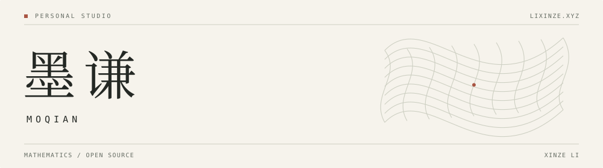

<picture>
  <source media="(prefers-color-scheme: dark)" srcset="assets/studio-header-dark.svg">
  
</picture>

  <a href="https://lixinze.xyz/">Website ↗</a>&nbsp;&nbsp; / &nbsp;&nbsp;
  <a href="https://www.linkedin.com/in/lixinze/">LinkedIn ↗</a>&nbsp;&nbsp; / &nbsp;&nbsp;
  <a href="https://x.com/xinzelimoqian">X ↗</a>&nbsp;&nbsp; / &nbsp;&nbsp;
  <a href="https://leanprover.zulipchat.com/#user/982434">Lean Zulip ↗</a>

I'm Xinze Li, also known as **Moqian / 墨谦**. This is my personal workspace for mathematical ideas, software experiments, and the people I build with.

I care about how knowledge becomes checkable, and how people and intelligent systems can work together. I explore these questions through mathematics, formal verification, and open source.

 

## Building communities

I help build **CloK** and **Varifold**. That means connecting collaborators, working through ideas together, and building the tools and shared resources that let others join in.

<table>
  <tr>
    <td width="50%" valign="top">
      <h3><a href="https://github.com/CloK-Lab">CloK ↗</a></h3>
      
A meeting place for theoretical research and practical problems. We work on formal mathematics, AI safety, and the ways research gets shared and supported.

      
<a href="https://www.clok.tech/">Explore CloK</a> · <a href="https://github.com/CloK-Lab">GitHub</a>

    </td>
    <td width="50%" valign="top">
      <h3><a href="https://github.com/Varifold-Lab">Varifold ↗</a></h3>
      
A community for studying the mathematical foundations of intelligent systems, with an emphasis on formal verification, AI safety, and multi-agent coordination.

      
<a href="https://varifold-lab.github.io/">Explore Varifold</a> · <a href="https://github.com/Varifold-Lab">GitHub</a>

    </td>
  </tr>
</table>

 

Have a question to work through, a tool to build, or a community to bring together? Find me on [LinkedIn](https://www.linkedin.com/in/lixinze/) or [X](https://x.com/xinzelimoqian).
